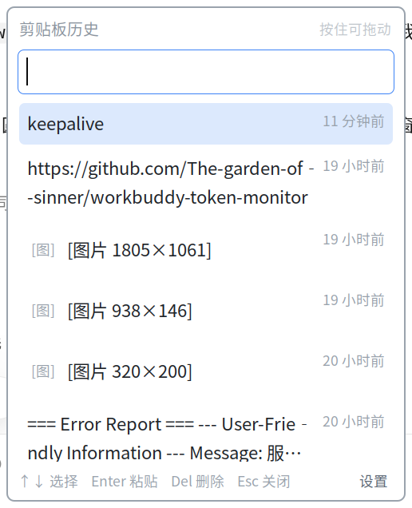

# SuperV-cliphist

**按下 `Super+V`，把复制过的东西原样叫回来。**  
纯文本、富文本、图片、文件四类内容，单文件实现，不依赖任何第三方包；
面向银河麒麟等国产 Linux 桌面环境调校。

   



## 亮点

- **装得上** —— 一个脚本文件，依赖只有系统自带的 GTK3 与 libX11。
  `apt` 被锁死、装不了 CopyQ 的机器，复制文件即可用。
- **粘得回** —— 四类内容都按原格式写回：带格式的段落粘进 WPS 仍是带格式的，
  文件粘进文件管理器仍然是文件，图片仍是原图。
- **写得省** —— 历史存 SQLite 并增量写入。同等数据量下，单次保存的写盘量约为
  JSON 全量重写的 1/170，延迟从 68 ms 降到 0.2 ms。
- **扛得住** —— 界面进程崩溃后由父进程在 1–5 秒内拉起；
  热键抓取失败会重试并清理残留实例；库损坏时自动隔离并用快照恢复。

## 关于修饰键的命名

Windows 系统中该组合键记作 `Win+V`，对应键盘左下角印有 Windows 徽标的按键。  
在 Linux / X11 环境下，同一物理按键的正式名称是 **Super**：

- keysym 为 `Super_L` / `Super_R`
- 修饰符为 `Mod4Mask`，源码中记作 `MOD_SUPER = 64`
- 该键位在 Apple 键盘上标注为 ⌘，在部分国产整机键盘上标注为麒麟标识

本文统一使用 `Super+V` 的表述。在系统设置或源码中检索快捷键时，应使用 Super 而非 Win。

## 功能

- **`Super+V` 全局热键** —— 任意应用中呼出，选中条目后自动粘贴回原窗口
- **四类内容支持** —— 纯文本、富文本（HTML 原文完整保存，粘贴保留样式）、
  图片、文件（记录真实路径，可粘出文件），自动识别
- **即时搜索** —— 输入关键词过滤，方向键选择，回车粘贴
- **外观可调** —— 字号 8–20 pt、背景透明度、历史条目上限，面板内修改并即时生效
- **位置记忆** —— 面板可拖动，位置自动保存；首次弹出定位于鼠标附近
- **无外部依赖** —— 仅使用系统预装的 GTK3 与 libX11

## 国产 Linux 环境适配

以下设计决策针对国产发行版的实际约束：

| 环境约束                             | 设计决策                                 |
| -------------------------------- | ------------------------------------ |
| `apt` 源受限或锁定，无法安装 CopyQ、GPaste 等 | 仅依赖 `python3-gi`、libX11 等系统预装库       |
| 桌面会话仍以 X11 为主，Wayland 未大规模部署     | 全局热键基于 `XGrabKey`，不依赖 Wayland portal |
| UKUI（麒麟）、DDE（UOS）未提供自定义命令快捷键入口   | 热键由程序自行抓取，不依赖桌面设置面板                  |
| 部分设备的 X 位图通道（MIT-SHM）不可用         | 界面采用 CSS 矢量绘制，位图相关功能设为可选项            |
| 分辨率与字体缩放配置差异较大                   | 字号以 pt 为单位，跟随系统 DPI                  |

开发与测试环境：银河麒麟桌面 V10 SP1 / UKUI 3.25 / X11。  
统信 UOS、中科方德等同源桌面基于相同的 GTK3 + X11 技术栈，理论可用，未逐一验证。

## 与 CopyQ 的对比

CopyQ 是该领域最成熟的项目（12k+ star，15 年迭代），功能覆盖显著超过本项目。  
两者定位不同：本项目以单文件实现换取最低的部署成本，把「复制—粘贴」这条主链路做完整；
CopyQ 覆盖面更广，固定条目、标签、脚本、正则搜索都是它更强。

下表按部署成本、交互方式与资源开销对比，优势项标记 ✅：

| 维度      | SuperV-cliphist      | CopyQ                       |
| ------- | -------------------- | --------------------------- |
| 部署方式    | ✅ 复制单个文件            | 13 个 Qt5 依赖，约 5 MB          |
| 运行时依赖   | ✅ 均为系统自带组件          | 需安装 Qt5 运行时                 |
| 全局热键    | ✅ 内置，安装即生效          | 默认未绑定，需在设置中添加 <sup>1</sup> |
| 开机自启    | ✅ 安装时自动配置           | 需在设置中手动启用 <sup>1</sup>      |
| 交互流程    | ✅ 呼出即可粘贴回原窗口        | 需配置方可达到相近效果                 |
| 常驻内存    | ✅ 约 53 MB <sup>2</sup> | 约 70 MB <sup>2</sup>       |
| 写入开销    | ✅ 单条约 12 KB（SQLite 增量） | 未实测                      |
| 国产发行版适配 | ✅ 针对 UKUI / X11 调校  | 通用实现                        |
| 设置界面    | 面板内三项核心参数           | ✅ 完整 GUI 设置面板               |
| 富文本格式保留 | ✅ 粘贴时保留样式 <sup>3</sup> | ✅                           |
| 图片缩略图   | -                    | ✅                           |
| 固定条目与标签 | -                    | ✅                           |
| 搜索能力    | 关键字子串匹配              | ✅ 支持正则表达式                   |
| 脚本与自动化  | -                    | ✅ 内置 JS 引擎                  |

> **1** — CopyQ 官方文档将「未设置全局快捷键」与「未启用开机自启」列为常见配置疏漏，  
> 两项均需在 `File → Preferences` 中手动开启。
>
> **2** — 内存为同机实测 RSS：本项目 53 MB（含热键线程、剪贴板监听与 SQLite 缓存）；  
> CopyQ 为同类 Qt5 程序的空载基准推算，未实际安装验证，仅供参考。
>
> **3** — 通过 ctypes 直接调用 GTK 的 `gtk_clipboard_set_with_data` 实现，
> 详见「实现说明」。接口不可用时自动降级为纯文本。

选型建议：若受限于软件源、希望安装即用，且主要在同一台机器上完成「复制—粘贴」
（四类内容都能按原格式粘回），本项目的部署与维护成本更低；
若需要图片缩略图预览、固定条目与标签管理、正则搜索或脚本自动化，CopyQ 更为合适。  
两者互不冲突，可并存试用。

## 安装

```bash
./install.sh
```

脚本依次完成：依赖检查 → 安装至 `~/.local/bin` → 配置开机自启 → 启动守护进程。

### 前置条件

| 组件                    | 说明                        |
| --------------------- | ------------------------- |
| python3-gi + GTK 3.24 | 主流桌面发行版预装                 |
| xdotool               | 用于激活原窗口并发送 `Ctrl+V`，需单独安装 |
| pycairo               | 可选，仅圆角渲染使用                |

```bash
sudo apt install python3-gi gir1.2-gtk-3.0 xdotool
```

### 不需要的操作

- **无需在系统设置中绑定快捷键** —— 程序通过 `XGrabKey` 自行抓取 `Super+V`
- **无需 root 权限** —— 全部安装至用户目录
- **无需重启** —— 脚本会立即启动守护进程，开机自启于下次登录生效

### 手动安装

```bash
install -Dm755 cliphist ~/.local/bin/cliphist
install -Dm644 cliphist.desktop ~/.config/autostart/cliphist.desktop
cliphist daemon &
```

## 使用

面板内操作：

| 按键        | 作用          |
| --------- | ----------- |
| `Super+V` | 呼出 / 收起     |
| `↑` `↓`   | 选择条目        |
| `Enter`   | 粘贴至原窗口      |
| `Del`     | 删除当前条目      |
| `Esc`     | 关闭          |
| 直接输入      | 按内容搜索       |
| 按住标题栏拖动   | 移动面板位置，自动保存 |

命令行：

```bash
cliphist            # 呼出面板
cliphist settings   # 打开设置
cliphist status     # 查看状态与条目数
cliphist font 12    # 快速修改字号
cliphist clear      # 清空历史（含图片文件）
cliphist stop       # 停止守护进程
```

## 配置

配置文件 `~/.config/clip-hist/config.json`，亦可通过设置面板修改：

| 键                 | 类型    | 默认      | 说明                    |
| ----------------- | ----- | ------- | --------------------- |
| `font_size`       | float | `11.0`  | 字号，8–20 pt            |
| `opacity`         | float | `1.0`   | 背景透明度，0.5–1.0         |
| `max_items`       | int   | `500`   | 历史条目上限，50–5000        |
| `show_thumbs`     | bool  | `false` | 列表内显示图片缩略图            |
| `argb`            | bool  | `false` | 圆角与半透明（需 ARGB 视觉，见下文） |
| `pos_x` / `pos_y` | int   | —       | 窗口位置，拖动后自动写入          |

数据目录 `~/.local/share/clip-hist/`：

```
history.db             # 条目数据（SQLite，WAL 模式）
history.json.migrated  # 从 JSON 迁移前的原始文件，保留用于回滚
snapshots/             # 每 72 小时一份可读 JSON 快照，保留最近 3 份
images/                # 图片原图与缩略图，按内容 md5 命名
daemon.log             # 界面进程的 stderr，崩溃原因写在这里（超过 256 KB 轮转）
```

## 已知限制

1. **图片缩略图默认关闭**。部分环境的 X 位图通道（MIT-SHM）不可用，  
   绘制位图将导致进程异常终止。可通过 `show_thumbs: true` 开启。
2. **圆角与半透明默认关闭**。原因同上：ARGB 窗口每次重绘均需经 MIT-SHM 上传 32 位位图。  
   可通过 `argb: true` 开启。
3. **富文本与文件写回依赖 GTK3 的 ABI**。通过 ctypes 调用
   `gtk_clipboard_set_with_data` 实现，若该符号或调用约定变化，
   会自动退回纯文本（内容不丢，格式丢失），不会崩溃。
4. **仅支持 X11**。依赖 `XGrabKey`，Wayland 会话下不可用。
5. 条目去重采用内容完全匹配，不做相似度合并。
6. **极短间隔的连续复制可能只保留最后一条**。剪贴板监听有 80 ms 合并窗口，
   用来避免富文本与截图连续触发多次 owner-change 时重复入库；  
   窗口内发生多次复制时，只能记录到窗口结束时剪贴板里的内容。

## 存储

历史存放在 `history.db`（SQLite，WAL + `synchronous=NORMAL`）。

同机实测，500 条 × 2000 字符（约 2.1 MB）：

| 方案 | 每次写盘 | 写延迟（中位） | 读全量 |
|---|---|---|---|
| JSON 全量重写 + 原子替换 | 2119 KB | 68 ms | 32 ms |
| SQLite 增量写 | 12 KB | 0.2 ms | 21 ms |

写放大差约 170 倍。剪贴板每复制一次就保存一次，条目里长文本越多，
全量重写的代价越明显；SQLite 只写变化的那几页。

首次启动会自动把旧 `history.json` 导入，原文件改名为
`history.json.migrated` **保留**。需要回滚时删掉 `history.db` 即可。

运行期每 72 小时导出一份可读 JSON 快照到 `snapshots/`，只保留最近 3 份。
库损坏时会把损坏文件改名为 `history.db.corrupt-<时间戳>`，
再用最近一份快照恢复。

## 实现说明

- **全局热键**：通过 `ctypes` 调用 libX11 的 `XGrabKey`，运行于独立线程与独立 Display 连接，  
  避免与 GTK 共用连接。需同时抓取 CapsLock / NumLock 的四种组合，  
  否则锁定键开启时热键失效。
- **热键冲突检测**：通过 `XSetErrorHandler` 统计抓取失败次数，热键被其他实例占用时输出告警。  
  Xlib 默认静默失败，缺失该检测将难以定位问题。崩溃重启后会重试 3 秒；
  仍然失败则断开残留的 cliphist 客户端再试一次。
- **单实例控制**：Unix socket 探测存活状态，`XKillClient` 清理跨 PID namespace 的残留进程。  
  `XKillClient` 不可置于启动流程中 —— 残留窗口的 resource id 会被新连接复用，  
  强制断开将同时中断新建立的连接。
- **图片存储**：按内容 md5 命名实现去重，另存 56 px 缩略图以避免大量原图占用内存。
- **面板绘制**：默认仅使用 CSS 矢量绘制，位图相关功能以可选项形式提供。
- **文件条目**：识别 `text/uri-list` 并优先于图片分支处理。文件管理器复制图片文件时
  会附带缩略图，若先走图片分支，存下来的就是那张缩略图，真实路径反而丢失。
- **多格式写回**：PyGObject 3.36 的 `Gtk.Clipboard` 只绑定了 `set_text` / `set_image`，
  而 `Gtk.Clipboard.__gpointer__` 是个 NULL PyCapsule，取不到对象地址。
  改为从 C 侧 `gtk_clipboard_get(CLIPBOARD)` 取同一个单例指针，
  用 ctypes 调用 `gtk_clipboard_set_with_data`，在回调里 `gtk_selection_data_set`：
  - 富文本写 `text/html` + `UTF8_STRING` + `text/plain`
  - 文件写 `text/uri-list` + `x-special/gnome-copied-files` + 纯文本路径
  回调与数据必须全局持有，否则被 GC 回收后 GTK 再取就是野指针。
- **崩溃自愈**：`daemon` 先 fork，父进程持有单实例锁并 `waitpid`，子进程运行 GTK。
  子进程异常退出时按 1–5 秒退避重启，正常退出（`stop`）则一同退出。

### 极端环境：MIT-SHM 不可用

部分麒麟 / 统信设备的 X 服务端与客户端不在同一个 `/dev/shm`，但
`XShmQueryExtension` 仍返回成功，导致 GDK 每次上传位图都收到 `BadValue`
并终止进程（`request_code 130`）。

`tools/noshm.c` 编译出的预载库让该函数返回 0，GDK 初始化时即关闭 SHM、
退回 `XPutImage`：

```bash
gcc -shared -fPIC -Wl,--version-script=tools/noshm.map \
    -o ~/.local/lib/cliphist/noshm.so tools/noshm.c
```

守护进程启动时若发现该文件会自动带 `LD_PRELOAD` 重新执行自己；文件不存在时
完全不影响正常环境。

## License

MIT
